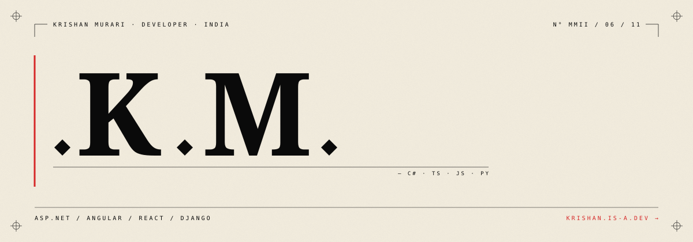

  

---

<table border="0" align="center" width="80%">
  <tr>
    <td valign="top" width="60%">

### what

Developer building for the web: interfaces, payments and shipping things end to end.

### now

Working on a Stripe and Apple Pay implementation.

### writing

Notes coming soon.

    </td>
    <td valign="top" width="40%" align="right">
      
<strong>SELECTED</strong> 
      <code>01</code> &nbsp; <a href="https://github.com/Krishanmurariji">your first project</a> 
      <code>02</code> &nbsp; <a href="https://github.com/Krishanmurariji">your second project</a> 
      <code>03</code> &nbsp; <a href="https://github.com/Krishanmurariji">your third project</a>

      
<strong>FIND</strong> 
      <a href="https://github.com/Krishanmurariji">github.com/Krishanmurariji</a> 
      <a href="mailto:mrkrishanmurariji@gmail.com">mrkrishanmurariji@gmail.com</a>

    </td>
  </tr>
</table>
